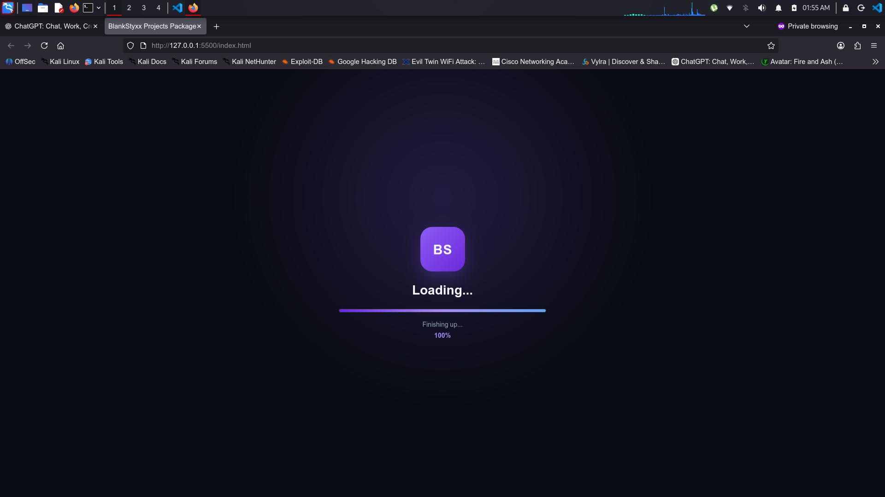
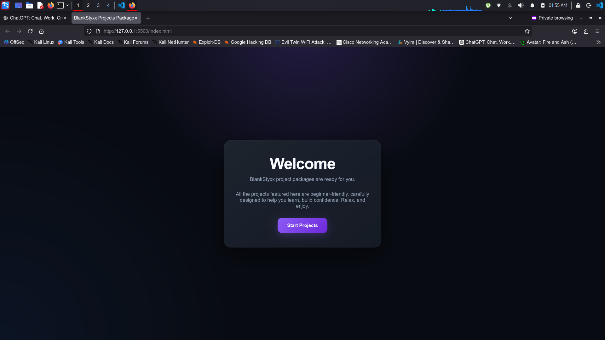
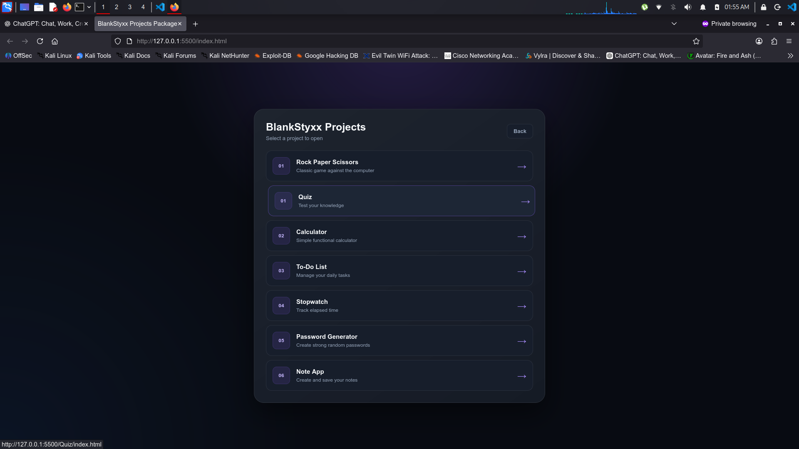
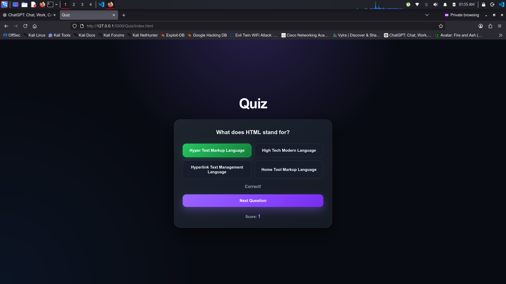
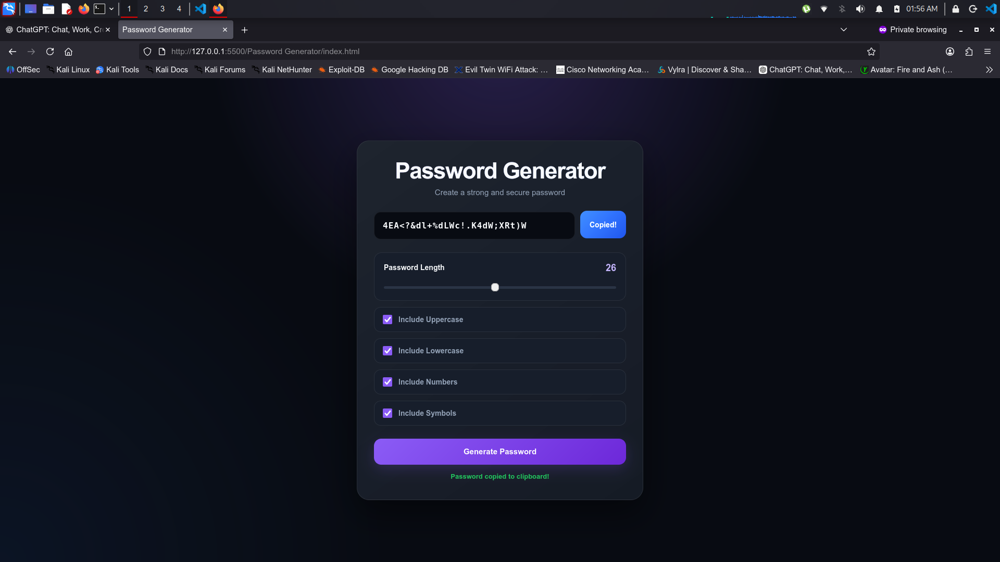

# Friendly Beginner Web Projects

A collection of beginner-friendly browser projects built with HTML, CSS, and JavaScript. The repository is designed for practice, experimentation, and hands-on learning in front-end development.

## Highlights

- 7 small interactive projects
- No framework or build step required
- Pure browser-based JavaScript
- Beginner-focused UI and learning flow
- Responsive design and local browser storage

## Included projects

| #   | Project             | Folder                | Description                                       |
| --- | ------------------- | --------------------- | ------------------------------------------------- |
| 1   | Rock Paper Scissors | `R_P_S/`              | Play against the computer and track rounds        |
| 2   | Calculator          | `calculator/`         | Perform arithmetic and scientific calculations    |
| 3   | To-Do List          | `To-Do/`              | Manage tasks with filters, priorities, and status |
| 4   | Stopwatch           | `Stopwatch/`          | Track time and run multiple countdowns            |
| 5   | Password Generator  | `Password-Generator/` | Generate secure passwords with customization      |
| 6   | Note App            | `Note-App/`           | Create, edit, and search notes in the browser     |
| 7   | Quiz App            | `Quiz/`               | Answer a small quiz and see your final score      |
| 8   | Project Launcher    | `index.html`          | Browse and open the full project set              |

## Quick start

1. Clone the repository:

```bash
git clone https://github.com/Blankstyxx/Friendly_Beginner_Web_Projects.git
cd Friendly_Beginner_Web_Projects
```

2. Start a local web server:

```bash
python3 -m http.server 8000
```

3. Open the app in your browser:

```text
http://localhost:8000
```

You can also open the landing page directly from `index.html`, but a local server is recommended for features such as clipboard access and browser APIs.

## Project structure

```text
Friendly_Beginner_Web_Projects/
├── index.html                  # Launch page and project browser
├── app.js                     # Launcher logic
├── style.css                  # Shared launcher styling
├── README.md                  # Project documentation
├── .gitignore
├── asset/                     # Shared assets
├── R_P_S/                     # Rock Paper Scissors game
├── calculator/                # Calculator app
├── To-Do/                     # Task management app
├── Stopwatch/                 # Stopwatch and countdown app
├── Password-Generator/        # Password generator app
├── Quiz/                      # Quiz app
├── Note-App/                  # Notes app
└── ...
```

## Learning goals

This project collection helps you practice:

- HTML structure and semantic markup
- CSS layout, theming, and responsiveness
- JavaScript DOM manipulation
- Event handling and state updates
- Timers, local storage, and browser APIs
- Project organization and reusable UI patterns

## Notes

- The project folder names were cleaned up to remove spaces and inconsistent naming so links work reliably across browsers and environments.
- The launcher page is the easiest way to browse all projects from one place.
- Most apps store their data in `localStorage`, so browser data can be cleared at any time.

## Contributing

Pull requests and improvements are welcome. If you want to add a new project, improve the UI, or fix a bug, feel free to fork the repo and open a change request.

## License

This project is currently provided for learning and personal development without a formal license file. If you plan to reuse or redistribute it publicly, consider adding a proper open-source license.

## BlankStyxx

A collection of frontend projects built while learning, experimenting with, and practicing HTML, CSS, and JavaScript.

---

# 📸 Preview

<p align="center">
  
  <br><br>
  
  <br><br>
  
  <br><br>
  
  <br><br>
  
</p>

---

# ⭐ Final Note

Learning to code isn't just about reading documentation or watching tutorials.

It's about building things, breaking things, fixing them, and trying again.

Every project in this collection is a small step toward becoming a better developer.

> **Learn by building. Build by experimenting. Improve by never stopping. 🚀**

If you find this repository useful, consider giving it a ⭐ to support the project!
